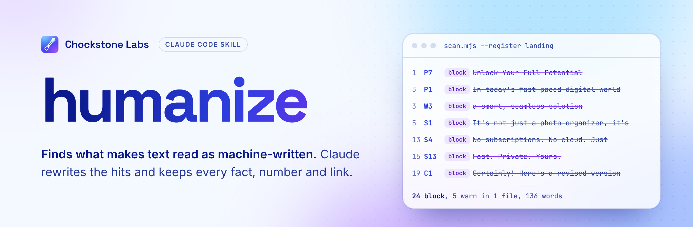

<a href="https://chockstonelabs.com/apps/?utm_source=github&utm_medium=readme&utm_campaign=humanize#skills">
  <picture>
    <source media="(prefers-color-scheme: dark)" srcset=".github/readme/banner-dark.png">
    
  </picture>
</a>

<p align="center">
  <a href="#install"><b>Install</b></a>&nbsp;&nbsp;·&nbsp;&nbsp;
  <a href="#what-it-catches"><b>What it catches</b></a>&nbsp;&nbsp;·&nbsp;&nbsp;
  <a href="#use"><b>Use</b></a>&nbsp;&nbsp;·&nbsp;&nbsp;
  <a href="https://chockstonelabs.com/?utm_source=github&utm_medium=readme&utm_campaign=humanize"><b>Chockstone Labs</b></a>
</p>

<p align="center">
  
  
  
  
</p>

<br>

humanize finds the patterns that make text read as machine-written, and Claude rewrites them.
Each pattern in the catalog has a stable id (C1, P1, S4, W1), so a hit in a review or a commit
message points at one rule and its fix. The scanner is a single Node file with no dependencies,
and a rewrite keeps every fact, number, name, quote and link as it was.

## What it catches

A landing page draft from the test fixtures, scanned (24 block hits, five shown):

```console
$ node scripts/scan.mjs --register landing tests/fixtures/ai-landing.md
tests/fixtures/ai-landing.md:1  P7 block  "Unlock Your Full Potential"  → Name the actual task or outcome in plain words.
tests/fixtures/ai-landing.md:3  P1 block  In today's fast-paced digital world: "In today's fast-paced digital world, managing your photos can feel…"  → Delete the scene-setting; open with the specific point.
tests/fixtures/ai-landing.md:5  S1 block  It's not just a photo organizer, it's: "…you to take control of your library. It's not just a photo organizer, it's a game-changer."  → State what it is. Drop the straw man it is not.
tests/fixtures/ai-landing.md:13  S4 block  No subscriptions. No cloud. Just: "No subscriptions. No cloud. Just your photos."  → Say what it does in one sentence; list the absences only if a reader asked.
…
tests/fixtures/ai-landing.md:19  C1 block  Certainly!: "Certainly! Here's a revised version of the text.…"  → Delete the opener and start with the answer.
humanize: 24 block, 5 warn in 1 file, 136 words. Exit 1.
```

And rewritten, with only the facts the draft already had:

```diff
- In today's fast-paced digital world, managing your photos can feel
- overwhelming. That's where Capysort comes in — a smart, seamless solution
- designed with you in mind.
- No subscriptions. No cloud. Just your photos.
+ Capysort groups the duplicates in your photo library. Your photos never
+ leave your device, and there is no subscription.
```

The catalog has seven families:

| Family | Catches | Example |
|---|---|---|
| **C** Chatbot residue | Openers, sign-offs, edit commentary | `Certainly!` `I hope this helps` |
| **P** Stock phrases | Scene-setting and stock promises | `In today's fast-paced digital world` |
| **S** Structure | Stock sentence shapes | `It's not just X, it's Y` `No X. No Y. Just Z.` |
| **F** Format | Dashes in copy, Title Case headings, bold-label bullets | `Sort photos — fast.` |
| **H** Hedging and filler | Padding and wordy connectors | `Due to the fact that` |
| **W** Words | Hype and AI-era vocabulary | `delve` `tapestry` `seamless` |
| **X** Dev text | Commit and PR habits | `This commit introduces` `Bug fixes and performance improvements` |

A phrase can be fine in an essay and wrong on a store listing, so each rule has a tier (block,
warn or info) in each of 14 registers: landing, store, ui, docs, email, social, release, commit,
pr, comment, legal, essay, chat and prose. The scanner picks the register from the file path.

## Install

Clone it into Claude Code's skills folder:

```bash
git clone https://github.com/chriscrosscutler/humanize ~/.claude/skills/humanize
```

To flag tells as Claude writes them, add the hook to `~/.claude/settings.json` under
`hooks.PostToolUse` with the matcher `Write|Edit|MultiEdit`:

```json
{ "type": "command", "command": "node ~/.claude/skills/humanize/scripts/hook.mjs 2>/dev/null || true" }
```

The hook reports block hits in the text just written. It never blocks a write.

## Use

In Claude Code:

| Command | Does |
|---|---|
| `/humanize <text or path>` | Rewrites the text, or the file in place |
| `/humanize check <text or path>` | Reports hits without rewriting |
| `/humanize audit [path]` | Writes a report on a project's copy to `docs/audits/` |
| `/humanize fix` | Applies the latest audit, one surface at a time |
| `/humanize voice <samples>` | Builds a profile of how you write, used to fill gaps in a rewrite |

From a shell, CI or a pre-commit hook:

```bash
node ~/.claude/skills/humanize/scripts/scan.mjs --register landing site/index.html
```

The scanner exits 0 when clean, 1 on a block hit and 2 on a usage error, so it works as a gate.
`--explain S4` prints one rule with its examples, `--git-log 20` reads commit messages, and
`--json` feeds other tools. A repo's `.humanize.json` sets registers per path, exemptions, project
rules and waivers with an expiry date ([references/audit.md](references/audit.md) §7).

## Layout

| Path | What it holds |
|---|---|
| [`SKILL.md`](SKILL.md) | The modes and ground rules, loaded on each use |
| [`references/`](references) | The catalog (`patterns.md`), tiers per register (`registers.md`), the voice profile, the audit procedure and the evidence behind each rule |
| [`scripts/scan.mjs`](scripts/scan.mjs) | The scanner; `--help` prints the flags |
| [`scripts/rules.json`](scripts/rules.json) | Every rule's id, pattern and tier per register |
| [`scripts/hook.mjs`](scripts/hook.mjs) | The PostToolUse hook |
| [`tests/`](tests) | Scanner, rules, hook and catalog drift tests, with fixtures |

## Tests

```bash
node --test
```

The catalog test fails when `references/patterns.md` and `scripts/rules.json` drift apart.

<br>

<p align="center">
  <a href="https://chockstonelabs.com/?utm_source=github&utm_medium=readme&utm_campaign=humanize"></a>
</p>
<p align="center">
  Made by <a href="https://chockstonelabs.com/apps/?utm_source=github&utm_medium=readme&utm_campaign=humanize"><b>Chockstone Labs</b></a>, a small app studio in Chagrin Falls, Ohio.<br>
  We also make <a href="https://capnolog.com">Capnolog</a>, <a href="https://spotmeter.app">SpotMeter</a>, <a href="https://capysort.com">Capysort</a> and <a href="https://lightdrills.com">LightDrills</a>, and the <a href="https://github.com/chriscrosscutler/video-edit">video-edit</a> skill.
</p>
